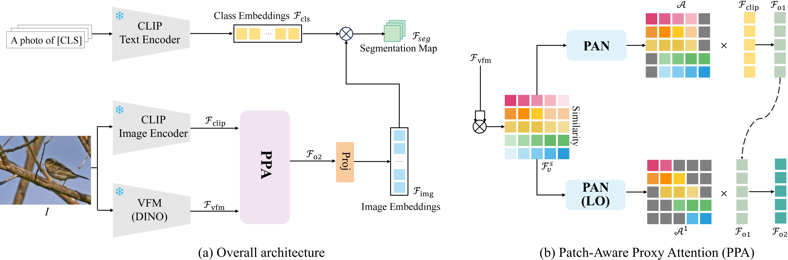
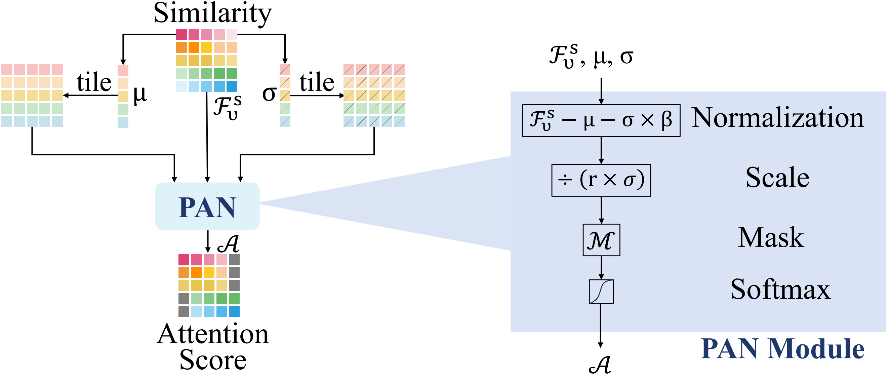

<div align="center">

<h1>PPA: Patch-Aware Proxy Attention for Open-Vocabulary Semantic Segmentation</h1>

<!-- <div>
    <a href='https://mc-lan.github.io/' target='_blank'>Mengcheng Lan</a><sup>1</sup>&emsp;
    <a href='https://chaofengc.github.io/' target='_blank'>Chaofeng Chen</a><sup>1</sup>&emsp;
    <a href='https://keyiping.wixsite.com/index' target='_blank'>Yiping Ke</a><sup>2</sup>&emsp;
    <a href='https://scholar.google.com.hk/citations?user=q4lnWaoAAAAJ&hl=en&inst=8669986779262753491&oi=ao' target='_blank'>Xinjiang Wang</a><sup>3</sup>&emsp;
    <a href='https://scholar.google.com.hk/citations?user=PnNAAasAAAAJ&hl=en' target='_blank'>Litong Feng</a><sup>3</sup>&emsp;
    <a href='https://www.statfe.com/' target='_blank'>Wayne Zhang</a><sup>3,4</sup>&emsp;
</div> -->
<!-- <div>
    <sup>1</sup>S-Lab, Nanyang Technological University&emsp; 
    <sup>2</sup>CCDS, Nanyang Technological University&emsp; 
    <sup>3</sup>SenseTime Research&emsp;
</div> -->
<!-- <div>
    <sup>4</sup>Guangdong Provincial Key Laboratory of Digital Grid Technology&emsp;
</div>

<div>
    <strong>Accepted to ECCV 2024</strong>
</div>

<div>
    <h4 align="center">
        • <a href="https://arxiv.org/abs/2408.04883" target='_blank'>[arXiv]</a> •
    </h4>
</div> -->

<!-- 


 -->


</div>

## Abstract
> *Open-vocabulary semantic segmentation aims to segment an image into arbitrary given semantic categories. Recently, the researchers explored to adapt the pre-trained CLIP for open-vocabulary semantic segmentation without any extra training, such as designing proxy attention to improve spatial representation of CLIP. In proxy attention, the key is to generate high-quality attention map from self-similarity map of vision foundation model (VFM). In this paper, we present a patch-aware proxy attention approach to improve the quality of attention map generated from VFM, named PPA. Our PPA contains two novel modules, including a patch-aware normalization  and a local optimization. The patch-aware normalization performs adaptive normalization on self-similarity map from VFM according to patch-aware means and variances, which can adaptively select contextually relevant patches for each query patch to generate attention scores. The local optimization further improves local segmentation with another patch-aware normalization that selects higher relevant patches for each query patch. In addition, local optimization employs penultimate layer of VFM to generate self-similarity map. We validate the effectiveness of our method on eight widely-used semantic segmentation datasets. Our method achieves promising performance on these datasets. Compared to original proxy attention, our method can significantly improve segmentation accuracy almost without increasing computational cost.*

## Dependencies and Installation


```
# git clone this repository
git clone https://github.com/zyqzyqhappiness/PPA.git
cd PPA

# create new anaconda env
conda create -n PPA python=3.10
conda activate PPA

# install torch and dependencies
pip install -r requirements.txt
```

## Datasets
We include the following dataset configurations in this repo following the instructions in [ProxyCLIP](https://github.com/mc-lan/ProxyCLIP):
1) `With background class`: PASCAL VOC, PASCAL Context, PASCAL Context 459 (PC459), Cityscapes, ADE20k, ADE847, and COCO-Stuff164k, 
2) `Without background class`: VOC20, Context59 (i.e., PASCAL VOC and PASCAL Context without the background category), and COCO-Object.


<!-- ## Quick Inference
```
python demo.py
``` -->


## Model evaluation
Please modify some settings in `configs/base_config.py` before running the evaluation.


```
python eval.py --config ./config/cfg_DATASET.py --workdir YOUR_WORK_DIR
```

Results will be saved in `results.xlsx`.

## Citation
<!-- 
```
 @inproceedings{lan2024proxyclip,
  title={Proxyclip: Proxy attention improves clip for open-vocabulary segmentation},
  author={Lan, Mengcheng and Chen, Chaofeng and Ke, Yiping and Wang, Xinjiang and Feng, Litong and Zhang, Wayne},
  booktitle={European Conference on Computer Vision},
  pages={70--88},
  year={2024},
  organization={Springer}
}
``` -->

<!-- ## License
This project is licensed under <a rel="license" href="https://github.com/mc-lan/SmooSeg/blob/master/LICENSE">NTU S-Lab License 1.0</a>. Redistribution and use should follow this license. -->


## Acknowledgement
This implementation is based on [ProxyCLIP](https://github.com/mc-lan/ProxyCLIP). Thanks for the awesome work.

## Contact
If you have any questions, please feel free to reach out at `zyq731@tju.edu.cn`.
